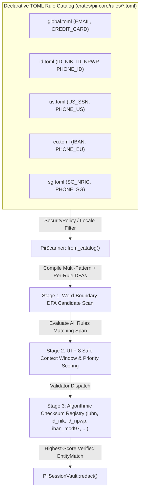
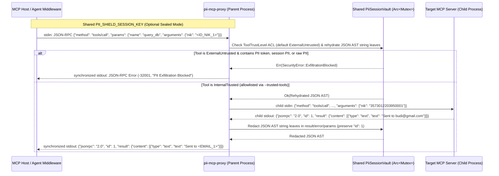

# International PII Catalog and Core Engine Remediation - Plan

## Goal Capsule

- **Objective:** Transform `pii-shield` from an Indonesia-only broken prototype into a contributor-friendly, data-driven international PII redaction and reversible pseudonymization engine, while remediating all compilation blockers, regex boundary defects, cryptographic weaknesses, streaming bugs, and incomplete proxy/FFI/Wasm implementations.
- **Authority hierarchy:** Product Contract requirements (`R1`–`R16`) govern product behavior; Key Technical Decisions (`KTD1`–`KTD7`) govern architecture and implementation mechanisms within those constraints; Implementation Units (`U1`–`U8`) define atomic execution boundaries.
- **Execution profile:** Test-driven remediation across a 4-crate Rust workspace (`pii-core`, `pii-mcp-proxy`, `pii-ffi`, `pii-wasm`).
- **Stop conditions:** All workspace crates compile cleanly on native and `wasm32-unknown-unknown` targets, `cargo clippy --workspace --all-targets -- -D warnings` and `cargo test --workspace` pass with zero warnings, and all implementation units `U1`–`U8` meet the Definition of Done.
- **Tail ownership:** Stay at plan creation during this invocation; downstream execution is owned by `ce-work` or `/goal` when invoked by the user.

---

## Product Contract

### Summary

Architect a declarative, locale-organized PII rule catalog (`global`, `id`, `us`, `eu`, `sg`) so contributors can add or update regional PII recognizers by editing TOML files alone, and remediate all critical/high/medium/low defects across `pii-core`, `pii-mcp-proxy`, `pii-ffi`, `pii-wasm`, and repository packaging.

### Problem Frame

`pii-shield` aims to provide sub-millisecond, stateful PII redaction and reversible pseudonymization for AI agents, MCP servers, and edge runtimes across both Indonesian (UU PDP) and international (GDPR, CCPA, PDPA) jurisdictions. However, an exhaustive audit of the repository uncovered fundamental disconnects between the specification and implementation:

1. **Goal & Extensibility Disconnect:** Entity patterns are hardcoded inside Rust source code (`crates/pii-core/src/scanner.rs`) with only four entities (`Email`, `IdNik`, `CreditCard`, `PhoneId`). Adding new international PII types or adjusting regional rules requires modifying Rust code rather than editing a declarative i18n rule database.
2. **Broken Compilation & Core Scanner Logic:** `crates/pii-core` fails to compile due to missing `meta` and `nfa-pikevm` features on `regex-automata`, and `crates/pii-wasm` fails on `wasm32-unknown-unknown` due to `ahash`'s default `runtime-rng` feature. Worse, patterns in `scanner.rs` use literal space characters (`r" \d{16} "`) instead of word boundaries (`\b`), causing `validate_indonesian_nik` (`bytes.len() != 16`) to reject 100% of NIKs, corrupting whitespace during redaction, missing PII adjacent to punctuation or inside JSON, and failing the repository's own unit tests and Quick Start example.
3. **Cryptographic & Rehydration Vulnerabilities:** `PiiSessionVault` uses a hardcoded static key (`*b"jotaralab-ephemeral-session-key!"`), lacks HMAC domain separation, leaves un-zeroized PII copies on the heap, and performs multi-pass `AHashMap` string replacement in `rehydrate()` that is vulnerable to secondary token expansion, $O(N \times M)$ complexity, and unescaped JSON injection in tool arguments.
4. **Incomplete Proxy, FFI, and Wasm Surfaces:** `pii-mcp-proxy` never spawns a downstream MCP server subprocess, corrupts JSON-RPC frames by running raw string regexes over structural JSON fields, and cannot share session state with an upstream Agent Middleware process. Meanwhile, `pii-ffi` exports a write-only vault with no rehydration functions or panic guards, and `pii-wasm` lacks streaming rehydration and tool ACL bindings.

### Requirements

**International PII Catalog & Contributor Workflow**

- R1. The engine must load PII entity definitions from declarative, per-locale TOML catalog files under `crates/pii-core/rules/` (including `global.toml`, `id.toml`, `us.toml`, `eu.toml`, and `sg.toml`) so contributors can add or update PII recognizers by editing a rule file without modifying Rust code.
- R2. Each declarative rule entry must support an entity identifier, tag prefix, locale code, word-boundary-safe regular expression, optional Stage-2 context keywords, a reference to a built-in Stage-3 checksum/structural validator (or `"none"`), match priority for span disambiguation, and embedded `valid_samples` / `invalid_samples` for automated catalog verification.
- R3. `SecurityPolicy` and locale selection must actively control which locale catalogs are loaded into `PiiScanner` (e.g., `IndonesiaUuPdpStrict` loads `global` + `id`; `StandardGlobal` loads `global` + configurable international packs; custom policies load caller-specified locales or external TOML files).

**3-Stage Cascading Sieve & Algorithmic Validators**

- R4. `PiiScanner` must implement the full 3-Stage Cascading Sieve: Stage 1 multi-pattern DFA candidate matching using zero-width word boundaries (`\b`) and ASCII character classes, Stage 2 overlap resolution and optional context-keyword verification, and Stage 3 algorithmic checksum/structural verification.
- R5. Built-in Stage-3 validators in `crates/pii-core/src/checksum.rs` must accurately verify:
  - `luhn`: 13–19 digits, starting and ending on an ASCII digit, rejecting consecutive separators and all-zero inputs.
  - `id_nik`: Exact 16 ASCII digits, validating against the exact 38 Kemendagri/BPS province codes, non-zero city/district codes, leap-year-aware calendar days per month (supporting `+40` female day offset), and non-zero serial suffix.
  - `id_npwp`: 15-digit and 16-digit formatted (`XX.XXX.XXX.X-XXX.XXX`) and unformatted Indonesian Tax IDs with valid taxpayer category prefixes (`01`–`09`), non-zero 6-digit taxpayer serial, valid KPP office code (`001`–`999`), and valid branch code (`000`–`099`).
  - `id_phone`: Indonesian mobile numbers (`+62`, `62`, `08xx`) verified against valid cellular operator prefixes and landline numbers (`021`, `022`, `024`, `031`, `0341`, `061`, etc.).
  - International validators: `us_ssn` (9-digit US SSN excluding invalid `000`, `666`, `900`–`999` area numbers and `00`/`0000` group/serials), `iban_mod97` (ISO 13616 mod-97 international bank account check), `sg_nric` (Singapore NRIC/FIN checksum), `e164_phone` (generic international phone structural/digit-length validator for `PHONE_US`, `PHONE_EU`, `PHONE_SG`), and `none` (structural regex-only pass-through for `EMAIL`).
- R6. When multiple candidate patterns match overlapping spans (such as a 16-digit Visa/Mastercard matching both the 16-digit numeric pattern and the credit card pattern), `PiiScanner` must evaluate all matching rules at that span and disambiguate deterministically by validator specificity, IIN prefix check, and rule priority without swallowing surrounding whitespace or punctuation.

**Session Vault Security, Memory Hygiene & Single-Pass Rehydration**

- R7. `PiiSessionVault` must generate a fresh 32-byte cryptographic session key via OS CSPRNG (`getrandom`) by default (failing closed if the platform CSPRNG is broken), while providing `PiiSessionVault::with_key` for deterministic testing and shared-key multi-process deployments.
- R8. `compute_hmac` must domain-separate digests by entity identifier (`<entity_id>\0<normalized_pii>`) and feed normalized bytes directly into `HmacSha256` without allocating un-zeroized intermediate heap strings.
- R9. `rehydrate` must execute a single-pass $O(M)$ left-to-right lexical scan for `<[A-Z0-9_:]+>` (supporting both `<ENTITY_N>` and uppercase hex sealed token envelopes `<PII:PREFIX:UPPER_HEX>`), looking up or decrypting each candidate token once in $O(1)$ time so that raw PII values containing token-like substrings are never recursively expanded.
- R10. `rehydrate_for_tool` must block `ToolTrustLevel::ExternalUntrusted` payloads whenever they contain (a) any known vault token (`<...>`), (b) any known raw PII value already stored in the session's `reverse_map.values()`, OR (c) any raw PII detected by `scanner.scan(payload)` (reporting a redacted descriptor like `<RAW_ID_NIK>` rather than echoing raw PII in the error), and must safely escape replacement strings when rehydrating inside structured JSON payloads for `ToolTrustLevel::InternalTrusted`.
- R11. `PiiSessionVault` must support an opt-in stateless sealed-token mode (using deterministic authenticated HMAC-SHA256-SIV encryption under `session_key` encoded in uppercase hexadecimal via `hex`) alongside default stateful counter tokens (`<ID_NIK_1>`) so separate processes sharing `PII_SHIELD_SESSION_KEY` can rehydrate tokens without an external database.

**Streaming Rehydration, MCP Proxy, FFI, Wasm & Repository Hygiene**

- R12. `StreamingRehydrator` must validate characters immediately following `<` against the legal uppercase token alphabet (`A`–`Z`, `0`–`9`, `_`, `:`) and flush non-matching sequences (such as `<div`, `<=`, or `< 5`) immediately without buffering up to 24 bytes.
- R13. `pii-mcp-proxy` must enforce a fail-closed default tool ACL (`ExternalUntrusted` unless allowlisted via `--trusted-tools` or `--trust-all-tools`), spawn the target MCP server command passed via CLI arguments over piped `stdin`/`stdout` with synchronized Host `stdout` writes, parse JSON-RPC 2.0 single and batch messages via `serde_json`, recursively rehydrate only string values inside `params.arguments` on `tools/call` (returning a JSON-RPC `-32001` error response if `ExfiltrationBlocked`), and recursively redact string values inside child responses and server notifications while keeping JSON-RPC `"id"` and structural fields intact.
- R14. `pii-ffi` must synchronize concurrent access to `PiiSessionVault` via an internal `Mutex`, guard all `extern "C"` functions with `std::panic::catch_unwind`, return `ptr::null_mut()` on string conversion errors, export full vault rehydration (`pii_vault_rehydrate`, `pii_vault_rehydrate_for_tool`) and streaming rehydrator (`pii_stream_*`) functions, and provide a `cbindgen` configuration and C header (`crates/pii-ffi/include/pii_shield.h`).
- R15. `pii-wasm` must compile cleanly on `wasm32-unknown-unknown`, implement `Default` on exported structs to satisfy `clippy::new_without_default`, and expose `rehydrate_for_tool`, locale/policy configuration, and `WasmStreamingRehydrator`.
- R16. The repository must include `LICENSE-MIT` and `LICENSE-APACHE` files, normalize source file permissions from `100755` to `100644`, commit `Cargo.lock`, make `scripts/setup-github.sh` idempotent, and include a stable-Rust benchmark target (`harness = false`) verifying `< 1.0 ms` scan/redaction latency.

### Acceptance Examples

- AE1. Punctuation-adjacent and JSON PII redaction (`Covers R4, R5, R6`)
  - **Given:** A `PiiSessionVault` initialized with `SecurityPolicy::IndonesiaUuPdpStrict`.
  - **When:** `vault.redact` is called on `"Tolong kirim invoice ke budi.santoso@gmail.com untuk NIK 3573012203950001."` and on `r#"{"nik":"3573012203950001","hp":"081234567890","npwp":"01.234.567.8-123.000"}"#`.
  - **Then:** The outputs are `"Tolong kirim invoice ke <EMAIL_1> untuk NIK <ID_NIK_1>."` and `r#"{"nik":"<ID_NIK_1>","hp":"<PHONE_ID_1>","npwp":"<ID_NPWP_1>"}"#` with all surrounding punctuation and whitespace preserved byte-for-byte.
- AE2. Secondary token injection defense (`Covers R9`)
  - **Given:** `<EMAIL_1>` maps to `"attacker+<ID_NIK_1>@evil.com"` and `<ID_NIK_1>` maps to `"3573012203950001"`.
  - **When:** `vault.rehydrate("Contact <EMAIL_1>")` is executed regardless of hash table iteration order.
  - **Then:** The output is strictly `"Contact attacker+<ID_NIK_1>@evil.com"` and never expands `<ID_NIK_1>` into `"3573012203950001"`.
- AE3. Contributor TOML rule validation (`Covers R1, R2`)
  - **Given:** A contributor adds a new `[[rules]]` entry with `id = "BR_CPF"` to a locale TOML file with `valid_samples` and `invalid_samples`.
  - **When:** `cargo test --workspace` runs.
  - **Then:** The automated catalog test suite parses the TOML file, compiles the multi-pattern DFA, asserts every `valid_sample` is detected as `BR_CPF`, and asserts every `invalid_sample` is rejected.
- AE4. Bidirectional MCP proxy JSON-RPC safety (`Covers R10, R13`)
  - **Given:** `pii-mcp-proxy` wraps a child MCP server and receives a JSON-RPC response `{"jsonrpc":"2.0","id":3573012203950001,"result":{"content":[{"type":"text","text":"NIK: 3573012203950001"}]}}`.
  - **When:** The proxy processes the child server's `stdout`.
  - **Then:** The numeric JSON-RPC `"id": 3573012203950001` is preserved untouched as a valid JSON number, while the string content is redacted to `"NIK: <ID_NIK_1>"`.

### Scope Boundaries

- Probabilistic ML/NLP Named Entity Recognition (such as transformer or spaCy models for arbitrary uncontextualized human names) is outside `pii-shield`'s deterministic zero-backtracking identity; person-name redaction is supported only via deterministic context-prefix rules (e.g., honorifics or labeled fields like `Nama:` / `Name:`) when enabled in a locale file.

#### Deferred to Follow-Up Work

- External Redis / PostgreSQL distributed vault backend for multi-node cluster state synchronization (stateless sealed tokens and in-memory vaults cover single-node and parent-child MCP proxy topologies in this plan).
- Automated npm (`wasm-pack`) and crates.io release publishing workflows in GitHub Actions.

---

## Planning Contract

### Key Technical Decisions

- KTD1. **Compile-time embedded TOML locale catalogs with bounded runtime override support** `(session-settled: user-approved — chosen over hardcoded Rust regex arrays or external-only runtime files: allows zero-IO startup in Wasm/FFI while letting contributors edit declarative TOML files)`. Embed built-in locale catalogs (`crates/pii-core/rules/*.toml`) via `include_str!` and parse them with `toml` + `serde`, while also exposing `PiiCatalog::from_toml_str` / `merge_toml_str` with explicit rule-count, regex-length, and DFA/NFA memory size limits (`nfa_size_limit`, `dfa_size_limit`) so custom runtime TOML rules cannot trigger compilation OOM. Cites R1, R2, R3.
- KTD2. **Deterministic HMAC-SHA256-SIV uppercase-hex sealed token mode alongside stateful session counters** `(session-settled: user-approved — chosen over requiring an external database or IPC daemon between Agent Middleware and pii-mcp-proxy: enables zero-dependency cross-process token rehydration via a shared PII_SHIELD_SESSION_KEY)`. Default to short stateful tokens (`<ID_NIK_1>`) so no ciphertext reaches external LLMs during normal sessions. When stateless/sealed mode is explicitly enabled (or when `pii-mcp-proxy` receives a sealed token `<PII:PREFIX:UPPER_HEX>`), encrypt/decrypt raw PII using a deterministic **Synthetic IV (HMAC-SHA256-SIV)** construction with HKDF-style domain-separated subkeys ($K_{\text{mac}} = \text{HMAC}(K, \text{"mac"})$, $K_{\text{enc}} = \text{HMAC}(K, \text{"enc"})\text{}$): compute a 16-byte authentication tag / Synthetic IV $SIV = \text{HMAC}(K_{\text{mac}}, \text{prefix} \parallel 0\text{x}00 \parallel P)[0..16]$, XOR-encrypt $P$ with counter-mode blocks $\text{HMAC}(K_{\text{enc}}, SIV \parallel \text{be32}(i))$, and encode $SIV \parallel C$ as **uppercase hexadecimal** via `hex` (`<PII:ID_NIK:A1B2...>`), preventing keystream reuse while staying 100% within the `[A-Z0-9_:]` token alphabet. Cites R7, R11, R12, R13.
- KTD3. **Deterministic context-prefix matching for `<PER_N>` instead of claimed free-text NER** `(session-settled: user-approved — chosen over claiming general person-name NER in a regex engine: preserves <1ms latency and low false-positive guarantees)`. Update `README.md` architecture diagrams to reflect deterministic entity recognition and provide an optional context-triggered rule mechanism (`context_keywords` / `context_prefixes`) in the TOML schema. Cites R2, R4.
- KTD4. **Multi-rule candidate span evaluation in `PiiScanner` to prevent `LeftmostFirst` single-pattern shadowing**. Enable `meta` and `nfa-pikevm` on `regex-automata` in `Cargo.toml`, and use ASCII character classes (`[0-9]`, `[A-Za-z]`) instead of Unicode `\d`/`\w` to keep the `.wasm` binary under 250 KB. Because `regex_automata::meta::Regex::find_iter` uses `MatchKind::LeftmostFirst` and returns only the lowest `PatternID` per span (which would shadow overlapping rules like `ID_NIK` vs `CREDIT_CARD` vs `ID_NPWP` when the first-matched pattern's Stage-3 validator fails), compile both a combined `multi_regex` for fast candidate start discovery and per-rule `Regex` instances: at each candidate match offset, evaluate all rules matching at that span, filter by Stage-3 checksum validation (`checksum::validate_by_name`), score passing candidates by `priority + context_bonus + span_len`, and advance the search cursor past the winning match (or by 1 char boundary if all candidate validators fail). Cites R4, R5, R6, R15.
- KTD5. **Single-pass lexical token scanner in `rehydrate()` and AST-aware JSON handling in `rehydrate_for_tool()`**. Parse `<...>` tokens in a single left-to-right pass over the input string ($O(M)$ time) with $O(1)$ lookup/decrypt via `rehydrate_token_into(&self, token: &str, out: &mut String) -> bool`. In `rehydrate_for_tool()`, enforce 3-layer exfiltration detection on `ExternalUntrusted` tools (vault tokens, known session PII in `reverse_map.values()`, and `scanner.scan(payload)`), and on `InternalTrusted` tools traverse and rehydrate string values in the `serde_json::Value` AST (including nested JSON string payloads) so replacement strings with quotes or backslashes are always validly escaped. Cites R9, R10.
- KTD6. **Target-conditional `getrandom` configuration for Wasm compatibility**. Configure `getrandom = "0.2"` in workspace dependencies and `[target.'cfg(target_arch = "wasm32")'.dependencies] getrandom = { version = "0.2", features = ["js"] }`, and configure `ahash = { version = "0.8", default-features = false, features = ["std", "compile-time-rng"] }`, allowing both `PiiSessionVault` CSPRNG key generation and `AHashMap` to compile and run cleanly on native and `wasm32-unknown-unknown`. Cites R7, R15.
- KTD7. **Bidirectional threaded STDIO proxy with synchronized Host `stdout` and fail-closed JSON-RPC AST traversal in `pii-mcp-proxy`**. Default unknown MCP tools to `ToolTrustLevel::ExternalUntrusted` (requiring `--trusted-tools` or `--trust-all-tools` for rehydration), spawn the downstream MCP server using `std::process::Command` with piped `stdin`/`stdout`, synchronize writes to Host `stdout` via a shared `Arc<Mutex<io::Stdout>>` (preventing deadlock when Thread 1 writes `-32001` error responses while Thread 2 reads `child_stdout`), drop `ChildStdin` on Host `stdin` EOF, and transform JSON-RPC string leaf nodes across both single objects and batch arrays. Cites R10, R13.

### High-Level Technical Design

#### 1. Declarative i18n Catalog Schema & 3-Stage Cascading Sieve



Directional TOML schema for contributor-editable locale files (`crates/pii-core/rules/id.toml`):

```toml
# Directional schema guidance for crates/pii-core/rules/id.toml
locale = "id"
name = "Indonesia (UU PDP)"

[[rules]]
id = "ID_NIK"
tag_prefix = "ID_NIK"
description = "Indonesian 16-digit National Identity Number (KTP)"
regex = '\b[0-9]{16}\b'
validator = "id_nik"
priority = 90
context_keywords = ["nik", "ktp", "identitas", "kependudukan"]
valid_samples = ["3573012203950001", "3573016203950002"]
invalid_samples = ["0073012203950001", "3573012203950000", "3573013102950001", "4000002203950001"]

[[rules]]
id = "ID_NPWP"
tag_prefix = "ID_NPWP"
description = "Indonesian 15/16-digit Tax Identification Number (NPWP)"
regex = '\b(?:[0-9]{2}\.[0-9]{3}\.[0-9]{3}\.[0-9]-[0-9]{3}\.[0-9]{3}|[0-9]{15,16})\b'
validator = "id_npwp"
priority = 95
context_keywords = ["npwp", "pajak", "tax"]
valid_samples = ["01.234.567.8-123.000", "012345678123000", "0012345678123000"]
invalid_samples = ["00.000.000.0-000.000", "99.234.567.8-000.000"]

[[rules]]
id = "PHONE_ID"
tag_prefix = "PHONE_ID"
description = "Indonesian mobile and landline phone numbers"
regex = '(?:\+62|\b62|\b0)[2-9][0-9\- ]{7,13}[0-9]\b'
validator = "id_phone"
priority = 80
valid_samples = ["081234567890", "+6281234567890", "6285212345678", "021-5551234"]
invalid_samples = ["080012345678", "01123456789"]
```

#### 2. Bidirectional MCP Proxy & Cross-Process Token Lifecycle



### System-Wide Impact

- **Public Rust API (`pii-core`):** `EntityType` evolves from a 4-variant `Copy` enum to a `Clone` enum supporting built-in variants (`Email`, `IdNik`, `IdNpwp`, `CreditCard`, `PhoneId`, `UsSsn`, `Iban`, `SgNric`, `PhoneUs`, `PhoneEu`, `PhoneSg`) plus `Custom(String)` for contributor rules, with `as_tag_prefix(&self) -> &str` returning a borrowed slice while preserving backward compatibility for existing callers of `EntityType::Email`, `EntityType::IdNik`, `EntityType::CreditCard`, and `EntityType::PhoneId`.
- **FFI Consumers (`pii-ffi`):** C/Go/Ruby/Elixir callers gain thread-safe `Mutex`-synchronized vault handles, `pii_vault_rehydrate`, `pii_vault_rehydrate_for_tool`, `pii_stream_*`, and `include/pii_shield.h` while preserving backward compatibility with existing `pii_vault_new` / `pii_vault_redact` / `pii_vault_free` / `pii_string_free` signatures.
- **Wasm Consumers (`pii-wasm`):** Browser and Cloudflare Worker users gain `WasmStreamingRehydrator` and `rehydrateForTool` while existing `new WasmPiiSession()`, `.redact()`, and `.rehydrate()` calls remain backward-compatible.

### Risks and Dependencies

| Risk | Impact | Mitigation |
|---|---|---|
| `regex_automata::meta::Regex::find_iter` returns only a single `PatternID` per span (`MatchKind::LeftmostFirst`), causing overlapping rules (e.g., 16-digit `CREDIT_CARD` vs `ID_NIK` vs `ID_NPWP`) to shadow each other when the first pattern's validator fails | Silent false negatives on valid NIKs or credit cards | Compile both a combined `multi_regex` (for candidate start detection) and individual per-rule `Regex` instances; at each candidate position, test all rules matching at that offset, run Stage-3 validators, pick the highest-scoring passing rule, and advance the search cursor manually via `Input::new(text).span(pos..text.len())` (`KTD4`, `U3`). |
| Homemade XOR stream cipher without a Synthetic IV in stateless sealed mode or lowercase Base64URL tokens breaking uppercase token lexers | Catastrophic keystream reuse ($C_1 \oplus C_2 = P_1 \oplus P_2$) or broken streaming rehydration | Use deterministic **HMAC-SHA256-SIV** ($SIV = \text{HMAC}(K_{\text{mac}}, \text{prefix} \parallel 0\text{x}00 \parallel P)[0..16]$, counter-mode keystream $\text{HMAC}(K_{\text{enc}}, SIV \parallel i)$) encoded in **uppercase hexadecimal** via `hex` (`<PII:PREFIX:UPPER_HEX>`) so tokens strictly use `[A-Z0-9_:]` (`KTD2`, `U4`, `U5`). |
| Wasm binary size exceeding `< 250 KB` budget when adding `toml` parser and Unicode regex tables | Violates `README.md` Wasm size badge | Restrict regex patterns to ASCII character classes (`[0-9]`, `[a-zA-Z]`) so `unicode-perl` tables are not required, and keep `toml` features minimal (`default-features = false, features = ["parse"]`). |
| Multi-byte UTF-8 characters straddling the $\pm 48$-byte Stage-2 context window or token boundaries | Runtime slice panic (`byte index is not a char boundary`) | Snap all context-window start/end indices to valid UTF-8 character boundaries (`is_char_boundary`) or perform ASCII keyword matching directly on `&text.as_bytes()[win_start..win_end]` (`U3`). |

---

## Output Structure

```text
.
├── .github/
│   └── workflows/
│       └── ci.yml
├── .gitignore
├── Cargo.toml
├── Cargo.lock
├── LICENSE-APACHE
├── LICENSE-MIT
├── README.md
├── crates/
│   ├── pii-core/
│   │   ├── Cargo.toml
│   │   ├── benches/
│   │   │   └── scanner_bench.rs
│   │   ├── rules/
│   │   │   ├── global.toml
│   │   │   ├── id.toml
│   │   │   ├── us.toml
│   │   │   ├── eu.toml
│   │   │   └── sg.toml
│   │   └── src/
│   │       ├── catalog.rs
│   │       ├── checksum.rs
│   │       ├── lib.rs
│   │       ├── scanner.rs
│   │       ├── stream.rs
│   │       └── vault.rs
│   ├── pii-ffi/
│   │   ├── Cargo.toml
│   │   ├── cbindgen.toml
│   │   ├── include/
│   │   │   └── pii_shield.h
│   │   └── src/
│   │       └── lib.rs
│   ├── pii-mcp-proxy/
│   │   ├── Cargo.toml
│   │   └── src/
│   │       └── main.rs
│   └── pii-wasm/
│       ├── Cargo.toml
│       └── src/
│           └── lib.rs
└── scripts/
    └── setup-github.sh
```

---

## Implementation Units

### U1. Workspace Dependencies, Wasm Target Compatibility, and Repo Hygiene

- **Goal:** Fix all Cargo workspace feature flags so `pii-core` and `pii-wasm` compile cleanly on both native and `wasm32-unknown-unknown` targets, add missing license files, normalize file permissions, and track `Cargo.lock`.
- **Requirements:** R15, R16, KTD6
- **Dependencies:** None
- **Files:**
  - `Cargo.toml`
  - `.gitignore`
  - `crates/pii-core/Cargo.toml`
  - `crates/pii-wasm/Cargo.toml`
  - `LICENSE-MIT`
  - `LICENSE-APACHE`
  - `scripts/setup-github.sh`
- **Approach:**
  1. In root `Cargo.toml`, update `regex-automata` features to include `"meta"` and `"nfa-pikevm"` alongside `"std"`, `"syntax"`, `"dfa-build"`, `"dfa-search"`, and `"hybrid"`.
  2. Add `toml = { version = "0.8", default-features = false, features = ["parse"] }` and `getrandom = "0.2"` to `[workspace.dependencies]`, configure `ahash = { version = "0.8", default-features = false, features = ["std", "compile-time-rng"] }`, add `toml.workspace = true` and `getrandom.workspace = true` under `[dependencies]` in `crates/pii-core/Cargo.toml`, and add `[target.'cfg(target_arch = "wasm32")'.dependencies] getrandom = { version = "0.2", features = ["js"] }` in `crates/pii-core/Cargo.toml` and `crates/pii-wasm/Cargo.toml` per KTD6. Keep `hex.workspace = true` in `crates/pii-core/Cargo.toml` for uppercase-hex sealed token encoding in `U4`.
  3. Remove `Cargo.lock` from `.gitignore`.
  4. Create standard `LICENSE-MIT` and `LICENSE-APACHE` files in the repository root.
  5. Make `scripts/setup-github.sh` idempotent (checking for existing `.git`, commits, and `origin` remote before running `git init`/`git commit`/`gh repo create`, and fixing the `jotralab` comment typo) and reset file modes from `100755` to `100644` on all non-script files.
- **Execution note:** This unit establishes buildability and packaging foundations; verify compilation of both native and `wasm32-unknown-unknown` targets immediately after updating manifests.
- **Patterns to follow:** Workspace dependency inheritance in `Cargo.toml`.
- **Test scenarios:**
  - **Happy path:** Workspace compiles cleanly for native target and `wasm32-unknown-unknown` target without missing feature errors.
  - **Edge case:** Running `git ls-files -s` shows mode `100644` for all `.rs`, `.toml`, `.md`, and `.yml` files and `100755` only for `scripts/setup-github.sh`.
- **Verification:** `cargo check --workspace` and `cargo check -p pii-wasm --target wasm32-unknown-unknown` succeed without errors.

### U2. Stage-3 Algorithmic Checksum & Structural Validators (`checksum.rs`)

- **Goal:** Harden existing `validate_luhn` and `validate_indonesian_nik` validators against false positives and separator bugs, and implement `validate_indonesian_npwp`, `validate_indonesian_phone`, `validate_us_ssn`, `validate_iban_mod97`, `validate_sg_nric`, and `validate_e164_phone` plus a named validator dispatcher for the declarative catalog.
- **Requirements:** R2, R5
- **Dependencies:** U1
- **Files:**
  - `crates/pii-core/src/checksum.rs`
- **Approach:**
  1. Harden `validate_luhn`: require the first and last bytes to be ASCII digits (`is_ascii_digit()`), reject consecutive spaces or hyphens (`--` or `  `), and keep the `(13..=19)` digit count and `sum > 0 && sum % 10 == 0` checks.
  2. Harden `validate_indonesian_nik`: accept an optional trimmed 16-byte slice, replace `(11..=96).contains(&prov)` with a binary search over the exact 38 valid Kemendagri/BPS province codes (`11..=19, 21, 31..=36, 51..=53, 61..=65, 71..=76, 81..=82, 91..=96`), and validate `day` against the exact days in `month` (`31` for Jan/Mar/May/Jul/Aug/Oct/Dec, `30` for Apr/Jun/Sep/Nov, `29` for Feb when `year % 4 == 0` else `28`).
  3. Implement `validate_indonesian_npwp`: support 15-digit unformatted (`012345678123000`), 16-digit unformatted (`0012345678123000` with leading `0` + 15-digit NPWP under PMK 112/2022), and formatted (`01.234.567.8-123.000`) strings, verifying valid taxpayer type prefix (`01`–`09`), non-zero 6-digit taxpayer serial, valid KPP office code (`001`–`999`), and valid branch code (`000`–`099`).
  4. Implement `validate_indonesian_phone`: strip optional formatting spaces/hyphens after prefix (`+62`, `62`, `0`), verify mobile numbers (`8xx`) against allocated Indonesian cellular operator prefixes (`811`–`819`, `821`–`823`, `831`–`833`, `838`, `851`–`853`, `855`–`859`, `877`–`878`, `881`–`889`, `895`–`899`) with total national significant number length 9–12 digits, and verify landline numbers against valid Indonesian area prefixes (`21`, `22`, `24`, `31`, `341`, `61`, `274`, `361`, `411`, `511`, `542`, `711`, `751`, `778`) with total length 8–11 digits.
  5. Implement international validators: `validate_us_ssn` (9 digits, area $\notin \{000, 666, 900..=999\}$, group $\neq 00$, serial $\neq 0000$), `validate_iban_mod97` (15–34 alphanumeric chars, country prefix + rearrange first 4 chars to end + ISO 7064 Mod 97-10 remainder `== 1`), `validate_sg_nric` (prefix `S`/`T`/`F`/`G`/`M` + 7 digits Weighted Mod-11 check letter), and `validate_e164_phone` (starts and ends on an ASCII digit or `+` prefix, rejects consecutive separators, and verifies 8–15 total digits with non-zero area/subscriber digits).
  6. Expose `pub fn validate_by_name(validator: &str, slice: &str) -> bool` to dispatch validator names referenced in TOML rule files (`"none"` or `""` returns `true`; `"luhn"`, `"id_nik"`, `"id_npwp"`, `"id_phone"`, `"us_ssn"`, `"iban_mod97"`, `"sg_nric"`, and `"e164_phone"` dispatch to their respective functions; unknown names return `false`) plus `pub fn is_known_validator(name: &str) -> bool` so `PiiCatalog` can reject typos in validator names at catalog load time.
- **Patterns to follow:** Zero-allocation byte-slice iteration in `crates/pii-core/src/checksum.rs`.
- **Test scenarios:**
  - **Happy path:** Valid NIKs (male and `+40` female), valid 15/16-digit formatted/unformatted NPWPs, valid Indonesian mobile/landline numbers, valid Luhn cards, valid US SSNs, valid IBANs (`DE89370400440532013000`), and valid Singapore NRICs return `true`.
  - **Edge cases:** Feb 29 leap year NIK (`3573012902960001`) returns `true`, while Feb 29 non-leap year (`3573012902950001`) and Feb 31 (`3573013102950001`) return `false`.
  - **Error paths:** Unassigned BPS province codes (such as `20`, `40`, `45` Visa prefix, `55` Mastercard prefix, `80`), consecutive hyphens in Luhn (`4532--0151-1283-0366`), leading/trailing hyphens (`-4532015112830366-`), unassigned Indonesian mobile prefix (`08401234567`), and US SSN area `666` or `000` return `false`.
- **Verification:** All unit tests in `crates/pii-core/src/checksum.rs` pass.

### U3. Declarative i18n Rule Catalog & 3-Stage Cascading Scanner (`catalog.rs`, `scanner.rs`, `rules/*.toml`)

- **Goal:** Create the contributor-friendly TOML rule catalog system (`global`, `id`, `us`, `eu`, `sg`) and rewrite `PiiScanner` to execute the 3-Stage Cascading Sieve with word-boundary DFA patterns, multi-rule candidate evaluation, context-keyword boosting, and priority-based overlap disambiguation.
- **Requirements:** R1, R2, R3, R4, R6, KTD1, KTD3, KTD4
- **Dependencies:** U1, U2
- **Files:**
  - `crates/pii-core/rules/global.toml`
  - `crates/pii-core/rules/id.toml`
  - `crates/pii-core/rules/us.toml`
  - `crates/pii-core/rules/eu.toml`
  - `crates/pii-core/rules/sg.toml`
  - `crates/pii-core/src/catalog.rs`
  - `crates/pii-core/src/scanner.rs`
  - `crates/pii-core/src/lib.rs`
- **Approach:**
  1. Create `crates/pii-core/src/catalog.rs` defining `LocaleCatalog`, `PiiRuleSpec`, `CatalogError`, and `PiiCatalog`. Include built-in TOML files via `include_str!` and provide `PiiCatalog::builtin_for_policy(policy: &SecurityPolicy)` (`IndonesiaUuPdpStrict` loads `global` + `id`; `StandardGlobal` loads `global` + `us` + `eu` + `sg`), `PiiCatalog::with_locales(&["global", "id", ...])`, and `PiiCatalog::merge_toml_str(&mut self, toml_src: &str) -> Result<(), CatalogError>` (enforcing a max of 256 rules, max 1,024-byte regex pattern length, and `checksum::is_known_validator(&rule.validator)`).
  2. Author the 5 built-in TOML rule files under `crates/pii-core/rules/` with no duplicate rule IDs across packs:
     - `global.toml`: `EMAIL` (`validator = "none"`, word-boundary regex rejecting consecutive dots and leading/trailing domain label hyphens: `\b[a-zA-Z0-9._%+\-]+@[a-zA-Z0-9](?:[a-zA-Z0-9\-]{0,61}[a-zA-Z0-9])?(?:\.[a-zA-Z0-9](?:[a-zA-Z0-9\-]{0,61}[a-zA-Z0-9])?)*\.[a-zA-Z]{2,}\b`) and `CREDIT_CARD` (`validator = "luhn"`).
     - `id.toml`: `ID_NIK` (`validator = "id_nik"`), `ID_NPWP` (`validator = "id_npwp"`), and `PHONE_ID` (`validator = "id_phone"`).
     - `us.toml`: `US_SSN` (`validator = "us_ssn"`) and `PHONE_US` (`validator = "e164_phone"`).
     - `eu.toml`: `IBAN` (`validator = "iban_mod97"`) and `PHONE_EU` (`validator = "e164_phone"`).
     - `sg.toml`: `SG_NRIC` (`validator = "sg_nric"`) and `PHONE_SG` (`validator = "e164_phone"`).
     Each rule must include comprehensive `valid_samples` and `invalid_samples`.
  3. Update `EntityType` in `crates/pii-core/src/scanner.rs` to derive `#[derive(Debug, Clone, PartialEq, Eq, Hash, Serialize, Deserialize)]` with built-in variants `Email`, `IdNik`, `IdNpwp`, `CreditCard`, `PhoneId`, `UsSsn`, `Iban`, `SgNric`, `PhoneUs`, `PhoneEu`, `PhoneSg`, and `Custom(String)`, and update `as_tag_prefix(&self) -> &str` to return a borrowed slice.
  4. Rewrite `PiiScanner` to compile with bounded `meta::Config` (`nfa_size_limit(Some(10 * 1024 * 1024))`, `dfa_size_limit(Some(2 * 1024 * 1024))`) and execute the 3-Stage Cascading Sieve in `PiiScanner::scan(&self, text: &str) -> Vec<EntityMatch>` per `KTD4`:
     - **Stage 1 (Multi-Rule Candidate Extraction):** Use `self.multi_regex.find(Input::new(text).span(pos..text.len()))` in a `while pos < text.len()` loop to locate the earliest candidate match start `mat.start()`. At `mat.start()`, test all compiled rules in `self.rules` whose individual `rule.regex.find(Input::new(text).span(mat.start()..text.len()).anchored(Anchored::Yes))` (or matching span at `mat.start()`) succeeds, so overlapping rules (e.g., `CREDIT_CARD` vs `ID_NIK` vs `ID_NPWP`) never shadow each other when one rule's Stage-3 validator returns `false`!
     - **Stage 2 (UTF-8 Safe Context & Priority Disambiguation):** Compute a $\pm 48$-byte context window around the candidate span using byte-level case-insensitive ASCII search on `&text.as_bytes()[win_start..win_end]` (never slicing `&str` at arbitrary byte offsets so multi-byte UTF-8 characters cannot panic), add a context bonus (`+25`) when any `rule.context_keywords` appear in the window, and disambiguate 16-digit numbers between `ID_NIK` and `CREDIT_CARD` (preferring `CREDIT_CARD` when `validate_luhn` passes and the prefix is a standard card IIN like `4x`/`51`–`55` unless `"nik"`/`"ktp"` context is present).
     - **Stage 3 (Checksum Verification & Cursor Advancement):** Filter candidates at `mat.start()` to those where `checksum::validate_by_name(&rule.validator, slice)` returns `true`. If one or more candidates pass, emit the highest-scoring `EntityMatch` and set `pos = winning_match.end()`; if all candidates at `mat.start()` fail Stage 3, advance `pos` to the next UTF-8 character boundary after `mat.start()` so subsequent matches are never skipped.
- **Execution note:** Write the automated TOML catalog test first so every `valid_samples` and `invalid_samples` entry across all 5 locale files is continuously verified against `PiiScanner`.
- **Patterns to follow:** `regex_automata::meta::Regex` and `Input` span search in `crates/pii-core/src/scanner.rs`.
- **Test scenarios:**
  - **Happy path:** `Covers AE1, AE3.` Every `valid_samples` item in `global.toml`, `id.toml`, `us.toml`, `eu.toml`, and `sg.toml` is matched with its exact `EntityType` and exact byte boundaries (no leading/trailing spaces included in `start..end`), and every `invalid_samples` item produces zero matches.
  - **Edge cases:** PII at byte index `0` (start of string), at `text.len()` (end of string), followed immediately by `.`, `,`, `!`, `?`, `)`, `]`, `}`, or `"`, surrounded by multi-byte UTF-8 characters (emojis/CJK/accented text within 48 bytes), and inside compact JSON `{"nik":"3573012203950001","phone":"081234567890"}` is detected with exact span boundaries and zero UTF-8 slice panics.
  - **Overlap disambiguation:** Both a valid 16-digit NIK (`3573012203950001`, regardless of whether it passes Luhn) and a 16-digit Mastercard (`5105105105105100`) / Visa (`4532015112830366`) are accurately classified as `EntityType::IdNik` and `EntityType::CreditCard` respectively without shadowing each other.
  - **Policy filtering:** `SecurityPolicy::IndonesiaUuPdpStrict` enables `global` + `id` rules; `SecurityPolicy::StandardGlobal` enables `global` + international packs (`us`, `eu`, `sg`) without false-matching Indonesian local numbers unless `id` is enabled.
  - **Custom contributor rule:** Calling `PiiCatalog::merge_toml_str` with a custom TOML `[[rules]]` entry (`id = "BR_CPF"`) dynamically adds the recognizer and redacts into `<BR_CPF_1>`.
- **Verification:** Automated catalog verification test and boundary/JSON scanner tests pass in `crates/pii-core`.

### U4. Session Vault Cryptography, Memory Zeroization, Single-Pass Rehydration & Stateless Mode (`vault.rs`)

- **Goal:** Remediate all cryptographic, memory-hygiene, algorithmic complexity, secondary token injection, and JSON escaping flaws in `PiiSessionVault`, and add support for cross-process shared keys and HMAC-SHA256-SIV stateless sealed tokens.
- **Requirements:** R3, R7, R8, R9, R10, R11, KTD2, KTD5, KTD6
- **Dependencies:** U2, U3
- **Files:**
  - `crates/pii-core/src/vault.rs`
- **Approach:**
  1. In `PiiSessionVault::new(policy: SecurityPolicy)`, generate `session_key` using `getrandom::getrandom(&mut key_bytes).expect("OS CSPRNG unavailable")` (failing closed on broken RNG, never falling back to predictable timestamps/addresses) and wrap in `Zeroizing::new(key_bytes)`. Add `PiiSessionVault::with_key(policy: SecurityPolicy, key: [u8; 32])`, `PiiSessionVault::with_sealed_key(policy: SecurityPolicy, key: [u8; 32])` (and `set_stateless_mode(&mut self, enabled: bool)`), and `PiiSessionVault::from_catalog(catalog: PiiCatalog)`.
  2. Update `compute_hmac(&self, tag_prefix: &str, raw_pii: &str) -> [u8; 32]` to domain-separate by feeding `tag_prefix.as_bytes()`, `&[0u8]`, and each byte of `raw_pii.trim()` lowercased inline (`b.to_ascii_lowercase()`) directly into `HmacSha256` without allocating a temporary heap `String`.
  3. Store `Zeroizing::new(raw_pii.trim().to_string())` in `reverse_map`, extract `let prefix = entity_type.as_tag_prefix().to_string()` before moving `entity_type` into `self.counters.entry(entity_type)`, and change `counters` from `u32` to `u64` (`saturating_add(1)`). When `stateless_mode` is enabled, emit deterministic HMAC-SHA256-SIV tokens `<PII:<PREFIX>:<UPPER_HEX>>` per `KTD2` using `hex::encode_upper`.
  4. Expose `pub fn rehydrate_token_into(&self, token: &str, out: &mut String) -> bool` (looking up stateful tokens in `self.reverse_map` in $O(1)$ time or verifying/decrypting `<PII:PREFIX:UPPER_HEX>` into a `Zeroizing<Vec<u8>>` buffer and appending directly to `out`), plus `pub fn rehydrate_token(&self, token: &str) -> Option<&str>` for stateful map lookups.
  5. Rewrite `rehydrate(&self, text: &str) -> String` as a single-pass $O(M)$ left-to-right lexical scanner that finds `<` and `>`, checks that the interior bytes match valid uppercase token characters (`b.is_ascii_uppercase() || b.is_ascii_digit() || matches!(b, b'_' | b':')`), calls `self.rehydrate_token_into(candidate, &mut out)`, and appends the raw value directly to `out` without ever re-scanning replaced substrings.
  6. Harden `rehydrate_for_tool(&self, payload: &str, trust_level: ToolTrustLevel) -> Result<String, SecurityError>` and expose `rehydrate_json_value(&self, value: &mut serde_json::Value, trust_level: ToolTrustLevel) -> Result<(), SecurityError>`:
     - When `trust_level == ToolTrustLevel::ExternalUntrusted`, enforce 3-layer inspection: (a) any vault token (`<...>`) or sealed token (`<PII:...>`), (b) any known session PII in `self.reverse_map.values()` (case-insensitive substring match and separator-stripped digit match), and (c) any raw PII detected by `self.scanner.scan(payload)`. Return `Err(SecurityError::ExfiltrationBlocked { token })` where raw/session PII triggers populate a redacted descriptor (`format!("<RAW_{}>", entity_prefix)`) so error responses never echo raw PII.
     - When `trust_level == ToolTrustLevel::InternalTrusted`, if `serde_json::from_str::<serde_json::Value>(payload)` succeeds, recursively rehydrate all string values in the JSON AST (also recursively rehydrating string leaves that themselves contain nested JSON objects/arrays) and serialize back via `serde_json::to_string` so any quotes or backslashes in PII are validly escaped; otherwise fall back to `self.rehydrate(payload)`.
- **Patterns to follow:** `Zeroizing` wrapper usage in `crates/pii-core/src/vault.rs`.
- **Test scenarios:**
  - **Happy path:** `Covers AE1.` Full agent roundtrip (`redact` $\rightarrow$ `rehydrate_for_tool(InternalTrusted)` $\rightarrow$ `rehydrate`) succeeds on prompts and DB rows containing `ID_NIK`, `ID_NPWP`, `EMAIL`, `PHONE_ID`, and `CREDIT_CARD` (including `test_agent_roundtrip_and_exfiltration_guard` and the `README.md` Quick Start).
  - **Security / Secondary token injection:** `Covers AE2.` When `<EMAIL_1>` maps to `"user+<ID_NIK_1>@example.com"` and `<ID_NIK_1>` maps to `"3573012203950001"`, calling `vault.rehydrate("Email: <EMAIL_1>")` 100 times always returns `"Email: user+<ID_NIK_1>@example.com"` and never leaks the NIK.
  - **Security / 3-layer exfiltration guard on untrusted tool:** Calling `vault.rehydrate_for_tool` with `ToolTrustLevel::ExternalUntrusted` blocks (a) `<ID_NIK_1>`, (b) a known session PII value from `reverse_map` even with stripped separators, and (c) an unredacted raw NIK `3573012203950001`, and the returned `ExfiltrationBlocked { token }` never contains the raw NIK plaintext.
  - **Security / JSON injection defense:** Rehydrating a token inside a JSON string argument (and inside a nested JSON string) where the underlying value contains `"` or `\` produces valid, properly escaped JSON.
  - **Cross-process sealed token SIV roundtrip & tamper rejection:** A token `<PII:ID_NIK:...>` redacted by Vault A in sealed mode with key `K` is accurately rehydrated by a freshly instantiated Vault B initialized with key `K` and an empty `reverse_map`, while flipping any hex byte in the SIV or ciphertext causes Vault B to leave the tampered token unexpanded.
- **Verification:** All unit tests in `crates/pii-core/src/vault.rs` pass.

### U5. Streaming Rehydrator State Machine Hardening (`stream.rs`)

- **Goal:** Fix `StreamingRehydrator` so non-token `<` characters flush immediately without 24-byte buffering lag, support $O(1)$ stateful and stateless token rehydration via `vault.rehydrate_token_into`, and handle long tokens and stream EOF (`flush()`) cleanly.
- **Requirements:** R12, KTD2
- **Dependencies:** U4
- **Files:**
  - `crates/pii-core/src/stream.rs`
- **Approach:**
  1. In `StreamingRehydrator::push_chunk`, when `ch == '<'` while `self.in_tag` is already `true` (e.g., `<<EMAIL_1>>`), flush the existing `self.buffer` to `output`, clear `self.buffer`, and push `'<'` while keeping `self.in_tag = true`. When `self.in_tag` is true and any character `ch` other than `<` or `>` arrives, validate immediately that `ch` belongs to the uppercase token alphabet (`ch.is_ascii_uppercase() || ch.is_ascii_digit() || matches!(ch, '_' | ':')`).
  2. If `!valid_token_char` or `self.buffer.len() > 160` (accommodating both standard `<CREDIT_CARD_1>` tags and uppercase-hex sealed `<PII:...>` tags), push `ch` to `self.buffer`, flush `self.buffer` to `output` immediately, clear `self.buffer`, and set `self.in_tag = false`.
  3. When `ch == '>' && self.in_tag`, push `'>'` to `self.buffer` and call `vault.rehydrate_token_into(&self.buffer, &mut output)` (appending `self.buffer` unchanged if it returns `false`), then clear `self.buffer` and set `self.in_tag = false` without allocating an un-zeroized intermediate `String`.
- **Patterns to follow:** Character-by-character state machine in `crates/pii-core/src/stream.rs`.
- **Test scenarios:**
  - **Happy path:** Split token chunks (`"<EM"`, `"AIL_"`, `"1>"`) and split sealed tokens (`"<PII:ID_"`, `"NIK:A1B2..."`, `">"`) across SSE chunks rehydrate seamlessly into the original PII.
  - **Edge cases:** HTML/Markdown/math chunks containing `<div class="box">`, `x < 5`, `a <= b`, or nested `<<EMAIL_1>>` emit `<div `, `< `, `<=` immediately on the first non-token character without waiting for 24 bytes or `>`.
  - **EOF flush:** Calling `stream.flush(&vault)` when the stream ends mid-tag (`"Hello <EMAIL_1"`) flushes the buffered characters cleanly so no trailing text is lost.
- **Verification:** All streaming unit tests in `crates/pii-core/src/stream.rs` pass.

### U6. Bidirectional MCP STDIO Proxy (`pii-mcp-proxy`)

- **Goal:** Re-architect `pii-mcp-proxy` into a true fail-closed bidirectional MCP STDIO subprocess wrapper that spawns the target MCP server, synchronizes Host `stdout` writes across threads, shares vault state (and cross-process keys via `PII_SHIELD_SESSION_KEY`), and safely transforms JSON-RPC 2.0 single and batch AST payloads.
- **Requirements:** R10, R11, R13, KTD2, KTD7
- **Dependencies:** U3, U4
- **Files:**
  - `crates/pii-mcp-proxy/Cargo.toml`
  - `crates/pii-mcp-proxy/src/main.rs`
- **Approach:**
  1. Parse CLI arguments in `crates/pii-mcp-proxy/src/main.rs`: enforce a **fail-closed (`ExternalUntrusted`) default** for all tools, supporting `--trusted-tools <comma-list>` (and `--trust-all-tools` for fully internal MCP servers, plus `--untrusted-tools` override), `--locales <comma-list>`, `--stateless` / `PII_SHIELD_SESSION_KEY` env var for cross-process key sharing, and `<command> [args...]` for the downstream MCP server binary. Maintain a fallback `--stdio-filter` mode if invoked without a downstream command.
  2. Implement `process_inbound_jsonrpc(line: &str, vault: &mut PiiSessionVault, acl: &ToolAcl) -> InboundAction` (returning `Forward(String)` or `BlockWithError(String)`) and `process_outbound_jsonrpc(line: &str, vault: &mut PiiSessionVault) -> String` using `serde_json::Value` (supporting both top-level JSON objects and `Value::Array` JSON-RPC batches):
     - On inbound `tools/call` objects, extract the tool name from `params.name`, determine its `ToolTrustLevel` from `acl`, and call `vault.rehydrate_json_value(&mut params["arguments"], trust_level)`. If `Err(SecurityError::ExfiltrationBlocked { token })` is returned, do **not** forward the call to the child MCP server; instead return a JSON-RPC 2.0 error response preserving the request's original `"id"` `Value` (or `Value::Null` if absent): `{"jsonrpc":"2.0","id":id,"error":{"code":-32001,"message":"PII exfiltration blocked for untrusted tool","data":{"token":token}}}`!
     - On outbound child `stdout` lines, parse as `serde_json::Value` and recursively redact string values inside `"result"`, `"error"`, and `"params"` (covering both tool responses and server-initiated notifications like `notifications/message`) while leaving `"jsonrpc"`, `"id"`, and `"method"` untouched. If a child `stdout` line is non-JSON text, fall back to `vault.redact(line)`.
  3. Spawn the child MCP server process with `Stdio::piped()` for `stdin` and `stdout` (`Stdio::inherit()` for `stderr`), share `Arc<Mutex<PiiSessionVault>>` and `Arc<Mutex<io::Stdout>>` across the two forwarding threads (locking `stdout` only per line write, never across blocking `child_stdout.lines()` reads), and move `ChildStdin` into Thread 1 so Host `stdin` EOF immediately drops `ChildStdin` and cleanly terminates the child process.
- **Patterns to follow:** Standard MCP JSON-RPC 2.0 newline-delimited STDIO framing.
- **Test scenarios:**
  - **Happy path:** `Covers AE4.` An inbound `tools/call` request for an allowlisted tool (`--trusted-tools query_db`) with whitespace (`"method": "tools/call"`) rehydrates `<ID_NIK_1>` inside `params.arguments`, forwards to the child server, and the child server's response has string values inside `result.content` redacted while numeric `"id": 3573012203950001` remains an uncorrupted JSON number.
  - **Security / Fail-closed default on unconfigured or untrusted tool:** A `tools/call` targeting any tool not in `--trusted-tools` (e.g., `web_search`) containing `<ID_NIK_1>`, known session PII, or raw NIK `3573012203950001` is blocked and returns a JSON-RPC `-32001` error on Host `stdout` without deadlocking or reaching the child server.
  - **Security / Batch & spoofed substring handling:** A JSON-RPC batch array `[{"jsonrpc":"2.0","id":"1","method":"tools/call",...}]` is inspected element-by-element, and a tool response whose text contains the literal string `"method":"tools/call"` is properly recognized as a response and redacted rather than rehydrated.
- **Verification:** Unit and integration tests (including subprocess STDIO roundtrip test) in `crates/pii-mcp-proxy` pass.

### U7. C-ABI FFI & WebAssembly Bindings Completeness (`pii-ffi`, `pii-wasm`)

- **Goal:** Complete the C-ABI (`pii-ffi`) and WebAssembly (`pii-wasm`) API surfaces with thread-safe handle synchronization, full rehydration, tool ACLs, streaming rehydration, panic safety (`catch_unwind`), `cbindgen` C headers, and Clippy compliance.
- **Requirements:** R14, R15
- **Dependencies:** U4, U5
- **Files:**
  - `crates/pii-ffi/Cargo.toml`
  - `crates/pii-ffi/cbindgen.toml`
  - `crates/pii-ffi/include/pii_shield.h`
  - `crates/pii-ffi/src/lib.rs`
  - `crates/pii-wasm/src/lib.rs`
- **Approach:**
  1. In `crates/pii-ffi/src/lib.rs`:
     - Wrap `PiiSessionVault` inside a thread-safe opaque handle (`pub struct PiiVaultHandle(Mutex<PiiSessionVault>);` or synchronize via `Mutex`) so concurrent calls from Go goroutines or Elixir dirty schedulers never create aliasing `&mut` / `&` Undefined Behavior.
     - Wrap every `extern "C"` entrypoint in `std::panic::catch_unwind(std::panic::AssertUnwindSafe(|| ...))`.
     - Replace `CString::new(...).unwrap_or_default().into_raw()` with `match CString::new(...) { Ok(s) => s.into_raw(), Err(_) => ptr::null_mut() }`.
     - Export `pii_vault_new_with_locales(locales: *const c_char) -> *mut PiiVaultHandle`, `pii_vault_rehydrate(ptr: *const PiiVaultHandle, input: *const c_char) -> *mut c_char`, `pii_vault_rehydrate_for_tool(ptr: *const PiiVaultHandle, payload: *const c_char, is_trusted: bool) -> *mut c_char` (returning `NULL` when blocked), and streaming functions `pii_stream_new()`, `pii_stream_push_chunk(stream: *mut StreamingRehydrator, vault: *const PiiVaultHandle, chunk: *const c_char) -> *mut c_char`, `pii_stream_flush(stream: *mut StreamingRehydrator, vault: *const PiiVaultHandle) -> *mut c_char`, and `pii_stream_free(stream: *mut StreamingRehydrator)`.
     - Add `crates/pii-ffi/cbindgen.toml` and `crates/pii-ffi/include/pii_shield.h`.
  2. In `crates/pii-wasm/src/lib.rs`:
     - Implement `Default` for `WasmPiiSession` and `WasmStreamingRehydrator` so `cargo clippy -- -D warnings` passes.
     - Add `WasmPiiSession::with_locales(locales: &str)`, `rehydrate_for_tool(&self, payload: &str, is_trusted: bool) -> Result<String, JsValue>`, and `WasmStreamingRehydrator` (`new`, `push_chunk`, `flush`).
- **Patterns to follow:** Pointer null-check and `Box::into_raw` / `Box::from_raw` lifecycle in `crates/pii-ffi/src/lib.rs`.
- **Test scenarios:**
  - **Happy path (FFI):** C-ABI roundtrip test creates a vault with `pii_vault_new`, redacts a prompt with `pii_vault_redact`, rehydrates tool args with `pii_vault_rehydrate_for_tool(..., true)`, streams chunks through `pii_stream_push_chunk` / `pii_stream_flush`, and frees all pointers without memory leaks or crashes.
  - **Error path (FFI):** Calling `pii_vault_rehydrate_for_tool(..., false)` with a redacted token returns `null_mut()`, and passing `null` pointers to any `pii_*` function safely returns `null_mut()` or no-ops.
  - **Happy path (Wasm):** `WasmPiiSession` and `WasmStreamingRehydrator` pass unit tests and `cargo check -p pii-wasm --target wasm32-unknown-unknown`.
- **Verification:** `cargo test -p pii-ffi`, `cargo test -p pii-wasm`, and `cargo clippy --workspace --all-targets -- -D warnings` pass.

### U8. Benchmarks, Documentation Alignment, and CI Verification

- **Goal:** Add a stable-Rust latency benchmark suite (`harness = false`) for `pii-core`, align `README.md` with the international declarative catalog and 3-Stage Cascading Sieve architecture, and ensure all rustdoc doctests, benchmarks, and CI checks pass.
- **Requirements:** R1, R3, R4, R16, KTD3
- **Dependencies:** U1, U2, U3, U4, U5, U6, U7
- **Files:**
  - `crates/pii-core/Cargo.toml`
  - `crates/pii-core/benches/scanner_bench.rs`
  - `README.md`
  - `.github/workflows/ci.yml`
- **Approach:**
  1. In `crates/pii-core/Cargo.toml`, declare `[[bench]] name = "scanner_bench" harness = false`, and create `crates/pii-core/benches/scanner_bench.rs` with a self-contained `fn main()` benchmark runner using `std::time::Instant` and `std::hint::black_box` (compatible with stable Rust in CI without nightly `#![feature(test)]`) measuring single-pass scan, vault redaction, and streaming rehydration latency across representative multi-entity prompts to verify the `< 1.0 ms` P99 claim.
  2. Update `README.md` to document:
     - International & Indonesian UU PDP support with the declarative TOML rule catalog (`crates/pii-core/rules/*.toml`) and a "Contributing a New PII Rule" guide showing how to add a recognizer by editing a TOML file alone.
     - Accurate 3-Stage Cascading Sieve explanation (Stage 1 DFA, Stage 2 Context & Priority Disambiguation, Stage 3 Algorithmic Checksum Verification) and accurate email matcher description (resolving the overstated full RFC-5322 claim).
     - Accurate fail-closed `pii-mcp-proxy` CLI usage (`pii-mcp-proxy --trusted-tools query_db -- <server-cmd>`) and shared-key / stateless mode.
     - Verified working Rust Quick Start code block that runs as a doctest.
  3. Update `.github/workflows/ci.yml` to add `cargo test --workspace --benches` so the `CI & Benchmarks` workflow compiles and executes the benchmark smoke suite alongside unit/integration tests and doctests.
- **Patterns to follow:** Existing `README.md` structure and `.github/workflows/ci.yml`.
- **Test scenarios:**
  - **Happy path:** `cargo test --doc` executes the `README.md` Quick Start example and passes all assertions.
  - **Benchmark smoke test:** `cargo test --workspace --benches` executes `scanner_bench` without errors or unused-main warnings under `clippy --all-targets`.
- **Verification:** Full CI suite (`cargo fmt --all -- --check`, `cargo clippy --workspace --all-targets -- -D warnings`, `cargo test --workspace`, `cargo test --workspace --benches`, and `cargo check -p pii-wasm --target wasm32-unknown-unknown`) passes cleanly.

---

## Verification Contract

| Gate | Command | Scope | Pass Criterion |
|---|---|---|---|
| Formatting | `cargo fmt --all -- --check` | Entire workspace | Exits 0 with zero diff |
| Linting | `cargo clippy --workspace --all-targets -- -D warnings` | All crates, tests, and benches | Exits 0 with zero warnings |
| Unit, Integration & Catalog Tests | `cargo test --workspace` | `pii-core`, `pii-ffi`, `pii-wasm`, `pii-mcp-proxy`, and all `rules/*.toml` samples | All tests pass (0 failures) |
| Benchmark Smoke Suite | `cargo test --workspace --benches` | `crates/pii-core/benches/scanner_bench.rs` | Benchmark harness runs and exits 0 |
| Documentation Doctests | `cargo test --doc` | `README.md` and rustdoc examples | All doctests pass |
| Wasm Target Compilation | `cargo check -p pii-wasm --target wasm32-unknown-unknown` | `pii-wasm` & `pii-core` | Compiles cleanly with zero errors |
| File Hygiene Check | `git ls-files -s` | Tracked repository files | All source/config/doc files have mode `100644`; only `scripts/*.sh` has `100755` |

---

## Definition of Done

- All 8 Critical, 6 High, 5 Medium, and 3 Low findings from the holistic architectural review are resolved.
- Declarative TOML locale catalogs (`global.toml`, `id.toml`, `us.toml`, `eu.toml`, `sg.toml`) are implemented under `crates/pii-core/rules/` and verified automatically via `valid_samples` and `invalid_samples` test suites (`U3`).
- Contributors can add a new PII entity recognizer purely by adding a `[[rules]]` block to a TOML file without editing Rust code (`R1`, `R2`).
- `PiiScanner` accurately detects `EMAIL`, `ID_NIK`, `ID_NPWP`, `CREDIT_CARD`, `PHONE_ID`, `US_SSN`, `IBAN`, `SG_NRIC`, `PHONE_US`, `PHONE_EU`, and `PHONE_SG` at string boundaries, before punctuation, and inside JSON payloads without single-pattern `LeftmostFirst` shadowing or corrupting surrounding whitespace (`U2`, `U3`).
- `PiiSessionVault` uses fail-closed CSPRNG session keys, domain-separated zeroized HMACs, single-pass $O(M)$ token rehydration, JSON-safe tool argument rehydration, 3-layer untrusted tool exfiltration blocking, and optional HMAC-SHA256-SIV uppercase-hex stateless sealed tokens (`U4`).
- `StreamingRehydrator` validates uppercase token characters immediately after `<` and flushes non-tags without delay (`U5`).
- `pii-mcp-proxy` enforces a fail-closed default tool ACL, spawns downstream MCP servers over STDIO with synchronized Host `stdout` writes, and safely transforms JSON-RPC 2.0 single and batch AST payloads (`U6`).
- `pii-ffi` and `pii-wasm` expose complete thread-safe redaction, rehydration, tool ACL, and streaming APIs with panic safety and C headers (`U7`).
- All Verification Contract commands pass with zero errors or warnings, and no abandoned experimental code remains in the working tree (`U1`–`U8`).
